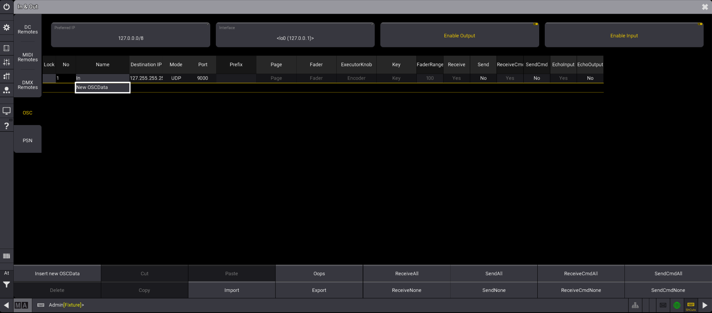

# grandMA3-Chataigne-Module

A Chataigne module to control grandMA3 via OSC

## Purpose

This Chataigne module facilitates the mapping of external sources to grandMA3 via the OSC interface. The faders and buttons of executors as well as directly of sequences can be changed. Of course there is also a function to send commands (cmd) to grandMA3. For all those who only use an onPC node there is the possibility to toggle "blind" and "freeze" and display the status for example on a midi controller.

## Features

The following functions are implemented in the plugin:

- Executor
    - Move Executor Fader
    - Push Executor Button
    - Turn Executor Encoder
    - Change Executor Speedscale
    - [Add Executor to SyncList](#sync-executors)
    - [Sync Executors](#sync-executors)
    - [Learn Executor feedback](#executor-feedback) from [pam-OSC](https://github.com/xxpasixx/pam-osc) LuaPlugin for ***gma3***.
- Sequence
    - Move Sequence Fader
    - Push Sequence Button
    - Track Sequence Running Status
- Master
    - Move Master Fader
    - [Move Master BPM Fader](#bpm-faders)
- Speed
    - Move SpeedMaster Fader
    - [Move SpeedMaster BPM Fader](#bpm-faders)
- Programmer
    - Turn Encoder
    - Set Color
- Control
    - Send Command
    - Set Preview
    - Set Blind
    - Set Freeze
    - Show Gui
    - Show View

The range of functions depends on the interface. For the executor faders and buttons, the function is determined by GrandMA3 on the playback page. The sequence faders and buttons can take on any functionality. So it is possible for example to map "Swop", "Speed", "Flash" and "Learn" of a sequence without making a setting in GrandMA3.

## Usage

Activate OSC in grandMA3 in the "In & Out" menu. The OSC input must be activated globally (top right) and an input source must be created. The screenshot shows a simple configuration as an example.



## Compatibility

grandMA3 2.5 changed the OSC syntax for sequences. A **Compatibility** dropdown is now in the module Parameters list so you can choose **2.5+** or **2.2 – 2.4**.

**2.5+ is the default.** If you are still on grandMA3 2.2–2.4, switch that dropdown or sequence control will not hit the right objects. This is a potentially breaking change if you update the module while running older than 2.5.

This module requires grandMA3 **2.2 or later**.

## Encoder

After the first feedback, it becomes clear that the encoder functionality is more important than I would have thought at first. I bought a MidiFighter Twister to test the functions. Since the mapping was too cumbersome for me, I wrote another [Chataigne module](https://github.com/yastefan/MidiEncoder-Chataigne-Module) that facilitates the mapping for endless encoders like in the MidiFighter.  
If you want other endless encoders supported, feel free to adapt the code and send it back to the project. This is the only way to create a good plugin. Unfortunately, I don't have another midi controller with endless encoders at my disposal and therefore can't do that.

## BPM Faders

The BPM faders allow to send BPM values (beats per minute) to executors or masters instead of values between 0 and 100%. This allows speeds in grandMA3 to be synchronized with external sources as:

- Ableton Link
- Midiclock
- CDJs/XDJs (via [BeatLinkTrigger](https://github.com/Deep-Symmetry/beat-link-trigger))
- Resolume

## Sync Executors

GrandMA3 sequences do not know a beat grid and are therefore difficult to synchronize with Resolume, Ableton or CDJs without further tools. In this plugin there are the functions **Add Executor to SyncList** and **Sync Executors** to enable synchronization to beats.  
**Add Executor to SyncList** Adds an executor to a list of executors to be synchronized. **Sync Executors** then restarts all executors on that list. Typically, Sync Executors is mapped to the beat signal, for example the **new Bar trigger** from Ableton Link. This way you can realize, for example, that dimmer phasers always have their maximum brightness on the kick.  On [freudundlight.de](https://freudundlight.de/Beat-Sync/) you can find an explanation of how you can use this function to realise a beat synchronisation between Pioneer CDJs and grandMA3.

## Sequence Feedback from grandMA3

When _OSC Input_ is configured and enabled, this plugin has the ability to read
and track various parameters of sequences as they are acted upon in grandMA3.

### Setup

Ensure that _OSC Input_ parameter is enabled and that MA3 has an _In & Out_
line configured for `Send` and `Send Command` to Chataigne's IP and _Local Port_.

### Learning & Tracking

This plugin can listen for commands and changes to MA3 sequences, allowing you
to create actions, mappings, and other workflows when -- for example -- a sequence
fires, stops, its master fader changes, etc.

In order for Chataigne to know about sequences in your show and their various
parameters, you first need to teach it. Switch on _Learn from oscInput_ in the
plugin parameters and fire a sequence event, such as a _Go+_, _Temp_, _Flash_, etc.
The plugin's _Values_ will now contain a _Sequences_ container with your sequence
number and the command that you triggered (and any associated values).

You only need to use _Learn from oscInput_ during this training phase. As long
as _OSC Input_ is enabled and the plugin instance knows about your sequences,
it will continue to receive and update whenever MA3 sends an OSC event.

The plugin features a special parameter in each sequence's value container
called _Running_. As long as the plugin has simply learned about the existence
of a sequence, it will attempt to track and follow any changes from MA3 (e.g.
_Go+_, _Temp_, _Flash_, _Black_, _Swop_, fader movements, and so on) -- regardless
of whether those parameters were added in the learning phase. If the plugin
believes your sequence is on/running, the _Running_ value will be `true`,
and `false` when off/stopped. This can be especially useful in mapping sequences
to status indicators.


## Executor Feedback
When you have the [pam-OSC](https://github.com/xxpasixx/pam-osc) ***LuaPlugin*** running on your ***GrandMA 3***, the the ChataigneModule will recognize its EncoderFeedback when "Learn from OSC" is enabled. And it will keep the learned Executors updated with the ***LuaPlugin***s feedback.


### Usage


See [setupinstuctions](https://github.com/xxpasixx/pam-osc/wiki/Setup#6-configure-grandma3) for the ***pam-OSC LuaPlugin***.

When the ***ChataignModule*** receives the Output of the ***LuaPlugin***(check this by "Log Incoming" in the ***Module***):
1. Activate "**Learn from oscInput**" in the ChataigneModule.
2. Restart the ***LuaPlugin*** in ***gma3***.
3. Look in the Values of the ***Module***.
    - There Should be **Containers** Called ```Executors```, ```Status``` and ```Page```.
4. Open the ```Executors``` Container.
    - There should be nested **Containers** 101, 201, 301, 401, ... . One for each ```ExecutorId```
5. Open a ```ExecutorId```s Container
    - There should be Values like ```Name```, ```Fader```, ```Button```, ```Color```.
6. Change the ```Page``` in the ***gma3***.
    - If you have differernt things on your Executors per Page, you should see the ```Name```, ```Color``` and Stuff change with the PageChange in ***gm3***.
7. Happy Mapping!
    - Use the Values from the ***gma3*** ChatingeModule to set Things on your MidiController, or what ever you use... . Like set the Color of a controllerButton to the Color of the coresponding ```Executor```.
    - Use the Commands of the ***gma3*** ChataingeModule to controll the ***gma3***. Like **pushExecutorButton** when an Button is presed on your MidiController.


### Tracked Features


**Per Executor**:
- ```Name```: String. The Name of the Sequence assigned to the Executor.
- ```Current Cue```: String. The Name of the running Cue of the Sequence assinged to the Executor.
- ```Color```: Array[r,g,b,a]. The BackgroundColor of the Appeareance assigned to the Sequence assigned to the Executor.
- ```Fader```: Float. The Value of the Fader/Knob of the Executor. (201 has a Fader, 401 has a Knob, but both are called Fader)
- ```Button```: Boolean. The State of the Button of the Executor, in repect to their assigned Function. (Like Toggle or Flash where for Toggle youd have to press the Button 2 times to get an "on" and "off" cycle, while for Flash its only on when pressed "on" and "off" when released.)

**Gloabl**:
- ```currentPage```: Integer. The Page of Executors currently activ on the ***gma3***.
- ```deskLocked```: Boolean. True if the ***gma3*** is currently locked.
    - For example to display a fancy Pattern as a Lockscreen on the Controller, or just to prohibit controll of the ***gma3***.